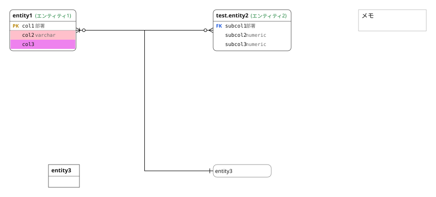
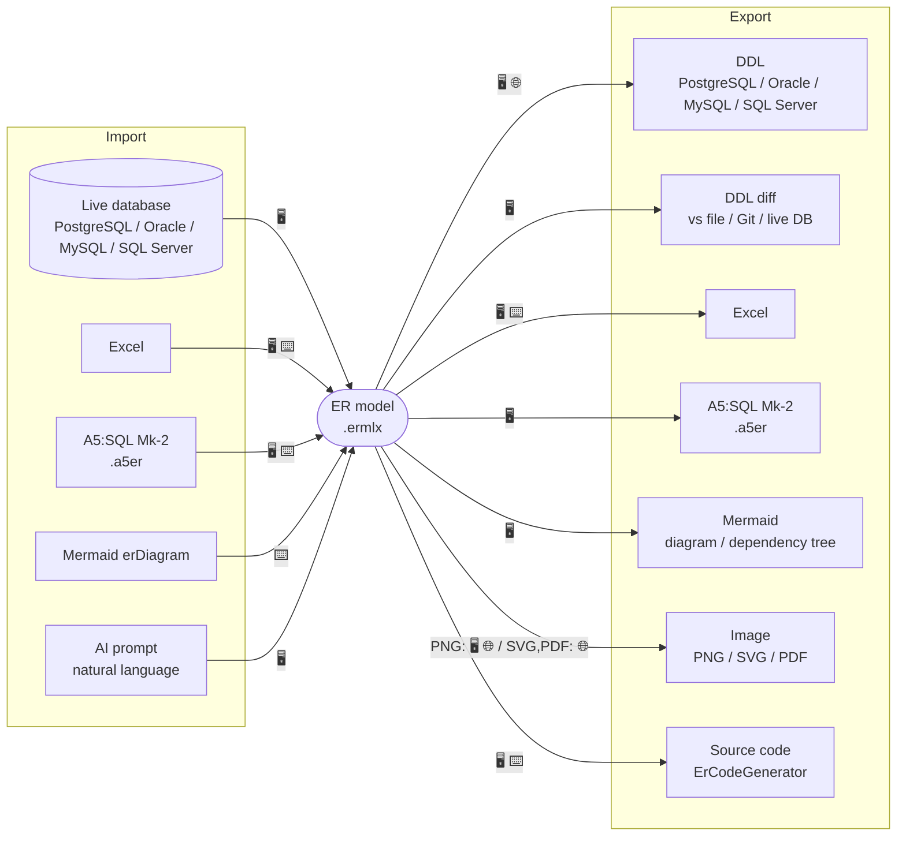

# ErCreator
This program is a tool for creating ER diagrams.

**▶ Try it in your browser (no install): https://rintaro-sugishita.github.io/ErCreator-releases/canvas**

The web version runs entirely in your browser (Blazor WebAssembly) — create ER diagrams, save/reuse them, and generate DDL. Live-database reverse engineering, Git versioning, and AI-assisted design/review are available in the desktop app ([download the latest release](https://github.com/Rintaro-Sugishita/ErCreator-releases/releases/latest)).

## Why ErCreator?
- **Free — including commercial use.** No account, no sign-up, no seat limits. (Not open source; all rights reserved — see [Terms](LICENSE.md).)
- **Runs 100% in your browser.** The web version does everything locally in WebAssembly — your schema never leaves your machine and nothing is uploaded, so it is safe to use on work databases. No server, and it works offline.
- **Speaks many formats.** Import from a live database, Excel, A5:SQL Mk-2, Mermaid, or an AI prompt; export DDL for four databases, plus Excel, Mermaid, images, and code — see [Import & Export](#import--export).
- **Real migration workflow.** Generate *differential* DDL by comparing your model against a file, a past Git commit, or a live database.
- **Git-friendly.** The `.ermlx` model is plain YAML text, so diffs and merges just work.
- **Yours, in your language.** Full Japanese / English UI, light & dark themes, undo/redo, and autosave.

## Function Overview
Beyond basic ER-diagram editing, ErCreator offers:
- **Wide import/export coverage** across databases, Excel, A5:SQL Mk-2, Mermaid, and AI — see [Import & Export](#import--export) below
- yaml-based (`.ermlx`) model that is easy to reuse and merges cleanly under Git
- Differential DDL generation — compare against a file, a past Git commit, or a live database
- Paste ranges of table-format data straight into grid cells
- Multiple ways to display attributes
- Extensible code generator (C# by default)
- AI-assisted design generation, editing, and review (desktop)

## Import & Export
One of ErCreator's strengths is how many formats it speaks. Everything flows through the native **`.ermlx`** model.

Legend: 🖥️ Desktop · 🌐 Web · ⌨️ CLI

| Format | Import | Export |
|---|:--:|:--:|
| **ermlx** (native project file) | 🖥️ 🌐 ⌨️ | 🖥️ 🌐 |
| **DDL** (PostgreSQL / Oracle / MySQL / SQL Server) | — | 🖥️ 🌐 &nbsp;·&nbsp; diff 🖥️ ⌨️ |
| **Live database** (reverse engineering) | 🖥️ | — |
| **Excel** (DB definition sheets) | 🖥️ ⌨️ | 🖥️ ⌨️ |
| **A5:SQL Mk-2** (`.a5er`) | 🖥️ ⌨️ | 🖥️ |
| **Mermaid** (erDiagram / dependency tree) | ⌨️ | 🖥️ |
| **AI** (design generation) | 🖥️ | — |
| **Image** (PNG / SVG / PDF) | — | PNG 🖥️ 🌐 &nbsp;·&nbsp; SVG,PDF 🌐 |
| **Source code** (ErCodeGenerator) | — | 🖥️ ⌨️ |

Full breakdown (Japanese): **[docs/import-export.md](docs/import-export.md)**.

## Installation
- **Web**: nothing to install — open https://rintaro-sugishita.github.io/ErCreator-releases/
- **Desktop (Windows)**: download the ZIP from the [latest release](https://github.com/Rintaro-Sugishita/ErCreator-releases/releases/latest), unzip, and run `ErCreator.exe`. The build is self-contained (single file), so no separate .NET runtime install is required.

## Usage
1. **Open the canvas** — on the web, click **Open ER Canvas** on the landing page.
2. **Add an entity (table)** — click **+ Entity**, then enter its name and columns.
3. **Edit an entity** — select it and edit its columns (name, type, PK/FK/UK, comments) in the side panel.
4. **Connect entities** — click **+ Relation** and drag between two entities to create a foreign-key relationship.
5. **Inspect / export** — use **Show ermlx** to view the model, or right-click an entity and choose **create table** to generate DDL (pick the target database type).

The UI is available in Japanese and English — switch with the **JA / EN** toggle.

## License / Terms of Use
ErCreator is **free to use, including for commercial use**, but it is **not open source** — all rights are reserved by the developer. See **[LICENSE.md](LICENSE.md)** (利用規約 / Terms of Use) for the full terms, including the no-warranty disclaimer and data-handling notes.

## History
