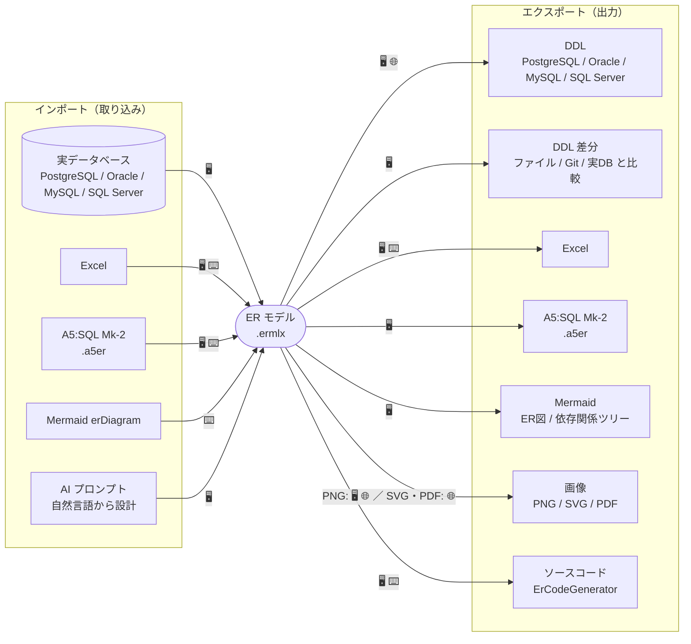

# インポート / エクスポート対応

ErCreator が読み書きできる形式の一覧です。中心にあるのは ErCreator のプロジェクトファイル
**ermlx**（YAML ベースのモデル）で、あらゆる取り込み・出力はこのモデルを経由します。

利用形態は 3 つあり、対応形式が異なります。

| 記号 | 形態 | 説明 |
|---|---|---|
| 🖥️ | **Desktop** | Windows デスクトップ版（WPF）。全機能。 |
| 🌐 | **Web** | ブラウザ版（Blazor WASM）。インストール不要・オフライン処理。 |
| ⌨️ | **CLI** | コマンドライン（`ercreator`）／Engine ライブラリ。 |

## インポート（外部 → ER モデル）

| ソース | 🖥️ Desktop | 🌐 Web | ⌨️ CLI | 備考 |
|---|:--:|:--:|:--:|---|
| **ermlx を開く** | ✓ | ✓ | ✓ | ネイティブ形式。Web はドラッグ＆ドロップも可。 |
| **実データベースのリバース** | ✓ | – | – | PostgreSQL / Oracle / MySQL / SQL Server に接続し、既存スキーマから ER 図を生成。 |
| **Excel から読み込み** | ✓ | – | ✓ | ドメイン定義・テーブル定義シートから復元。CLI は `convert --from-excel`。 |
| **A5:SQL Mk-2（.a5er）** | ✓ | – | ✓ | CLI は `convert --from-a5er`。 |
| **Mermaid（erDiagram）** | – | – | ✓ | `convert --from-mermaid`。自動整列で座標を付与。 |
| **AI から生成** | ✓ | – | – | 自然言語プロンプトから DB 設計を生成（BYO-API-key）。CLI は AI スキーマ JSON を `convert --from-aischema`。 |

## エクスポート（ER モデル → 外部）

| 形式 | 🖥️ Desktop | 🌐 Web | ⌨️ CLI | 備考 |
|---|:--:|:--:|:--:|---|
| **ermlx で保存** | ✓ | ✓ | — | ネイティブ形式。 |
| **DDL 生成** | ✓ | ✓ | – | PostgreSQL / Oracle / MySQL / SQL Server。Web はエンティティ右クリック→「create table」/「drop → create table」。 |
| **DDL 差分生成** | ✓ | – | ✓ | 別ファイル / Git ログ / 実DB と比較して ALTER 等を生成。CLI は `diff`。 |
| **Excel** | ✓ | △ | ✓ | 定義書として出力。Web は開発用 `/ddl` ページでのみ試験的。CLI は `export --format excel`。 |
| **A5:SQL Mk-2（.a5er）** | ✓ | – | – | |
| **Mermaid** | ✓ | – | – | ER 図（全体 / 現在ページ）と依存関係ツリー。 |
| **画像 PNG** | ✓ | ✓ | – | |
| **画像 SVG / PDF** | – | ✓ | – | Web のみ（クライアント側で生成）。 |
| **ソースコード生成** | ✓ | – | ✓ | ErCodeGenerator（テンプレートベースのコード生成）。CLI は `generate`。 |

## 補足

- **ermlx** は YAML ベースのテキスト形式なので、Git 差分が読みやすく、バージョン管理に向いています。
- Web 版はすべてブラウザ内（WASM）で処理し、モデルをサーバーへ送信しません。実DB リバース・Git 連携・AI 機能は Desktop 版専用です。
- CLI（`ercreator`）は `convert` / `export` / `diff` / `generate` / `list-generators` を提供します。
